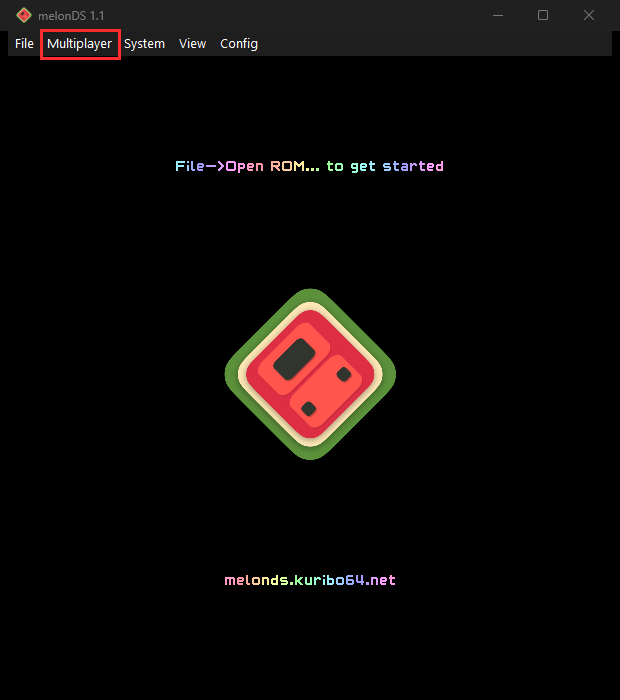
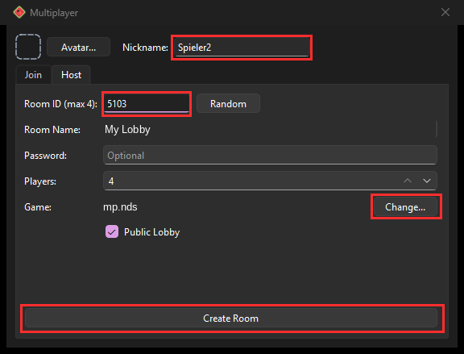
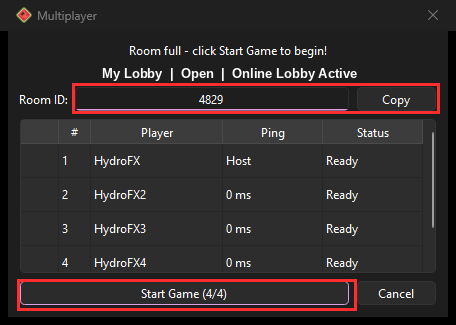
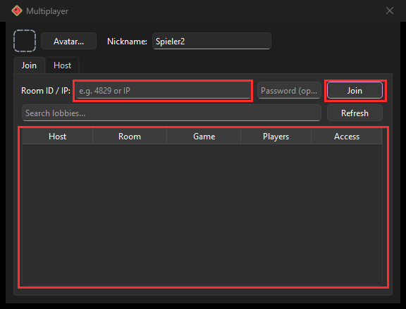

# melonDS Multiplayer

Play Nintendo DS games online with **2–4 friends** — including games that use **DS Download Play** / local wireless.

> **No games or system files are included.** You need your own legally obtained copies of the BIOS, firmware and game files (e.g. dumped from your own console). Nothing here links to or provides ROMs or BIOS files.

## Features
- **Simple Host & Join:** Create a room with a 4-digit Room Code (optional password)
- **Works over the internet:** No manual port forwarding or Hamachi needed in most setups
- **2–4 Players + Crossplay:** Play together on Windows and macOS (Apple Silicon, Experimental)

## How to Play

1. Download the file for your system from [Releases](https://github.com/hydr0fx/melonDS-Multiplayer/releases) and extract it:
   - **Windows:** `melonDS-Multiplayer-Windows.zip`
   - **macOS (Apple Silicon, Experimental):** `melonDS-Multiplayer-macOS.zip`
2. Put `bios7.bin`, `bios9.bin`, `firmware.bin`, and your `.nds` game into the **`BIOS and ROM`** folder (all players need the same ROM, BIOS, and firmware files).
3. Launch the emulator:
   - **Windows:** Open **`melonDS.exe`**.
   - **macOS (Experimental):** Open **`melonDS.app`**. If macOS blocks the first launch, right-click → **Open**, or run `xattr -cr melonDS.app` once in Terminal.
4. Click **Multiplayer** in the top menu:

5. **Host:** Click **Multiplayer → Host Room...**, enter your nickname, select your ROM (`Change...`), pick a 4-digit Room ID, and click **Create Room**:

6. Share your **Room ID** (`Copy`), wait for your friends to join, and click **Start Game**:

7. **Join:** Friends click **Multiplayer → Join Room...**, enter the **Room ID** (or double-click a public room), and click **Join**:

8. **In-Game (Download Play):** If the game uses DS Download Play, the host starts the multiplayer / wireless mode in the game, and everyone else opens *DS Download Play* from the DS home screen.

## Quick Tips
- **Laptops & MacBooks:** Plug in your charger and turn off **Low Power / Battery Saver** mode for better perfomance.
- **Firewall:** Allow `melonDS` in the Windows / macOS firewall popup when asked.

## Disclaimer
This is an unofficial, fan-made project and is **not affiliated with, endorsed by, or sponsored by Nintendo**. All trademarks and game titles belong to their respective owners. No copyrighted game data, BIOS or firmware is distributed.

## License
Open-source fork of [melonDS](https://github.com/melonDS-emu/melonDS), licensed under GPLv3 ([LICENSE](LICENSE)).
